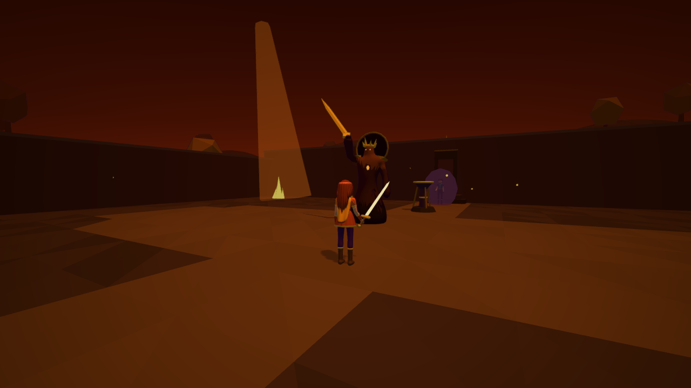

# Ceniza y Luz

Cruza la Bruma, encuentra la luz y recupera a tu hermano.

Aventura de acción 3D en tercera persona para navegador, con un mundo pequeño por explorar. Una noche la Bruma ataca tu aldea y se lleva a uno de los gemelos. Elige a Alba o a Ciro, toma la Hoja de Luz y recorre cinco zonas con enemigos, cofres, puzzles y un mercader hasta el jefe final.

Un solo jugador, sin conexión, en español. Se juega con teclado y ratón en un navegador de escritorio.



## Contenido

Edad orientativa: 13+. Es una orientación propia, no una clasificación oficial.

Fantasía oscura: combate contra criaturas que se desvanecen en ceniza, ambientes tensos y misteriosos, sin sangre ni imágenes explícitas. Incluye efectos de luz y movimiento de cámara que se pueden reducir en el juego.

## Controles

| Tecla              | Acción                                                |
| ------------------ | ----------------------------------------------------- |
| W A S D            | Moverse                                               |
| Mayús (mantener)   | Caminar                                               |
| Ratón o flechas    | Mover la cámara                                       |
| Clic izquierdo o J | Atacar (pulsa varias veces para un combo de 3 golpes) |
| Espacio            | Esquivar                                              |
| Q                  | Pulso de Luz (cuando lo aprendas)                     |
| R                  | Impulso (cuando lo aprendas)                          |
| E                  | Hablar, abrir, empujar, descansar                     |
| I                  | Inventario                                            |
| Esc o P            | Pausa                                                 |
| M                  | Silencio                                              |
| Tab                | Salir del juego con el teclado                        |

## Accesibilidad

Desde los ajustes se puede reducir el parpadeo y el movimiento, ajustar la sensibilidad y el campo de visión, invertir el eje vertical, agrandar el texto, reducir el daño recibido y jugar sin sonido. La cámara nunca se mueve sola, los puzzles no tienen temporizador y los diálogos avanzan solo cuando el jugador lo pide.

## Datos que guarda

El juego no recolecta nada: no hay cuentas, cookies, analítica, anuncios ni servicios de terceros. Solo guarda en el `localStorage` de tu navegador, con el prefijo `cenizayluz:`:

- `cenizayluz:settings`: tus ajustes.
- `cenizayluz:save`: tu partida (personaje elegido, lugar, inventario y progreso).

Estos datos no salen de tu navegador. Se borran con el botón «Borrar datos guardados en este navegador» de los ajustes. El servicio de alojamiento puede registrar direcciones IP, como cualquier sitio web.

## Desarrollo

Requiere Node.js 24.

```bash
npm ci            # instala las dependencias exactas del lockfile
npm run dev       # servidor de desarrollo
npm run lint      # ESLint y Prettier
npm run test      # pruebas de la lógica
npm run build     # genera dist/
npm run preview   # sirve dist/ para probarlo
```

La explicación de cómo está hecho el juego está en [docs/ARCHITECTURE.md](docs/ARCHITECTURE.md); la de los modelos 3D, en [docs/ART.md](docs/ART.md); y las herramientas de depuración, en [docs/DEBUG.md](docs/DEBUG.md).

## Despliegue

`dist/` es un sitio estático con rutas relativas: funciona en cualquier alojamiento o subcarpeta, sin servidor propio ni peticiones a otros dominios.

El repositorio se publica en GitHub Pages con GitHub Actions: cada push a `main` pasa el lint, las pruebas y el build, y solo entonces despliega. Para activarlo, en Settings → Pages elige «GitHub Actions» como origen.

Para incrustarlo en otra página:

```html
<iframe
  src="https://dannnyusssssss.github.io/Ceniza-y-Luz/"
  title="Ceniza y Luz"
  sandbox="allow-scripts allow-same-origin allow-pointer-lock"
></iframe>
```

## Licencia

Todos los derechos reservados. Titular: Danny Sivinta. Consulta [LICENSE](LICENSE) y las licencias de terceros en [docs/LICENSES.md](docs/LICENSES.md).

Contacto: cuartojuegos.contacto@gmail.com
